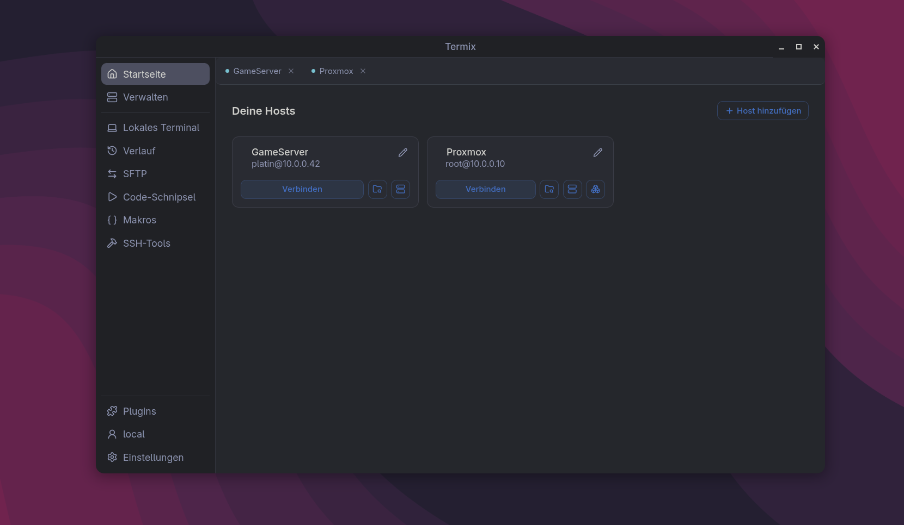

# Compact Layout

A layout plugin for [Termix](https://github.com/Termix-SSH/Termix), with a matching
pair of themes. Forked from [Simple Layout](https://github.com/Termix-SSH/Plugin-Simple-Layout).

The idea: **the tab bar lists what is running, and nothing else.** Everything you
navigate to lives in a rail on the left that you arrange yourself. Opening Settings
no longer costs a tab you have to close again; it is a place you go to and leave.



*Shown with Termix's default theme, not one of the two bundled here.*

## What it does

**Layout — "Compact"**

- A home screen with a card per host. Connect opens a new session every time.
- A rail on the left with every destination, plugin panels included. Simple Layout
  filters panels out, which is why Snippets has nowhere to appear there.
- Reorder the rail and switch entries off under **Settings → Sidebar**. The choice is
  stored in Termix's own rail preferences, so it follows you to other layouts.
- **Every settings page the stock layout has**, in the same four groups:
  your account (security, API keys, data and sync), this app (interface,
  appearance, sidebar, keyboard shortcuts), the plugins, and the server
  (general, updates, users, sessions, roles, host defaults, database, SSL,
  API keys, audit log). Branding is the only one missing, and it cannot be
  built -- see below.
- The tab bar holds open connections only: status dot, monospace, mouse-wheel scrolling.
  Closing a tab lands on the next session, or on Home when it was the last one.
- A Snippets button in the terminal's bottom toolbar.
- No right edge rail, no docks, no split view.

**Themes — "Termius Dark" and "Termius Light"**

A desaturated blue-grey shell with an azure accent: the rail a step darker than the
content, the terminal the darkest surface on screen. Both set all 35 design tokens
and `--radius`.

## Install

**From the registry**, which also keeps it up to date. Under
Plugins → Registries → Add registry, paste

```
https://raw.githubusercontent.com/Platin117/termix-plugins/main/index.json
```

Click Check, compare the key id Termix shows with `6f86998b60df416c`, then
trust and add. The plugin is now under Browse, and every later version turns
up under Updates. No developer mode needed.

**From a file**, if you would rather not trust a registry. Turn on Plugin
developer mode (Settings → Server in this layout, General in the stock one),
download the `.tmxplug` from the [latest release](https://github.com/Platin117/termix-compact-layout/releases/latest)
and upload it in the Plugins area. Updating is then yours to do by hand.

Either way, pick the layout and a theme under Settings → Appearance.

Requires Termix 26.10.3 or newer.

## Build

There is no system-wide Node on the machine this was written on; `nodeenv.sh` runs
everything inside a Flatpak SDK sandbox. If you have Node 24, ignore it and use npm
directly.

```bash
./nodeenv.sh "npm install && npm run build && npm test && npx termix-plugin validate"
```

```bash
./nodeenv.sh "npx termix-plugin pack"
```

## Releasing

`git tag v1.2.3 && git push --tags`. The Release workflow builds, tests,
validates, packs, signs, publishes the release and writes the version into the
shared registry index in
[Platin117/termix-plugins](https://github.com/Platin117/termix-plugins), so one
URL in Termix covers every plugin:

```
https://raw.githubusercontent.com/Platin117/termix-plugins/main/index.json
```

The `index.json` still in this repository is written too, for anyone whose
Termix points at the old URL. It can go once nobody does.

Two repository secrets are needed:

- `TERMIX_PLUGIN_SIGNING_KEY` — base64 PKCS8, which is what
  `npx termix-plugin keygen` writes.
- `REGISTRY_TOKEN` — a fine-grained GitHub token with contents read/write on
  `Platin117/termix-plugins` and nothing else.

The tag has to match the version in `manifest.json`, and the public key in the
index can never change without everyone removing the registry and trusting it
again. It is the same key as before, so the key id stays `6f86998b60df416c`
and nobody has to re-trust anything when they switch URL.

## Two rules that reach past this plugin

`src/frontend/layout/CompactLayout.tsx` carries a small stylesheet that touches
markup this plugin does not own. Both are patches, not fixes: if those components
are restyled the rules stop matching, and the old appearance returns. Nothing breaks.

**Rounding.** Termix's UI kit is square by design — it writes `rounded-none` in 42
places and never reads the `--radius` token the themes set. Rounded cards next to
sharp-edged dialogs read as a mistake rather than a style, so inside this layout
anything with a full border or a card surface and no radius of its own follows the
theme. The tooltip arrow is excluded: it is a square rotated 45 degrees, and
rounding it turns the point into a blob.

**A label in Host Metrics.** Its CPU/memory/disk labels in the terminal toolbar have
a fixed `w-12` and no truncation. "Memory" fits in 48px; the German
"Arbeitsspeicher" does not, and runs under the bar beside it. The rule lets the
label size itself. The real fix belongs upstream.

## What is not in scope

The bottom toolbar of a session and its "Image" button belong to the SSH Terminal
plugin. A layout can contribute buttons to it but cannot take any away. A minimap of
the scrollback is not possible either: the terminal's side panel slot receives only
the host, never the buffer.

**Branding.** The one settings page the stock layout has and this one does
not. The plugin API exports `getBranding` and `useBranding` and no way to
write any of it back, so the page would be a read-only copy of something you
cannot change from here. Switch to the stock layout to set it.

## Credits

Forked from [Plugin-Simple-Layout](https://github.com/Termix-SSH/Plugin-Simple-Layout)
by the Termix project, Apache-2.0. The host editor, the host and credential lists,
the settings pages, the command palette and the mobile bottom bar are theirs,
unchanged. See `NOTICE`.

## License

Apache-2.0.
